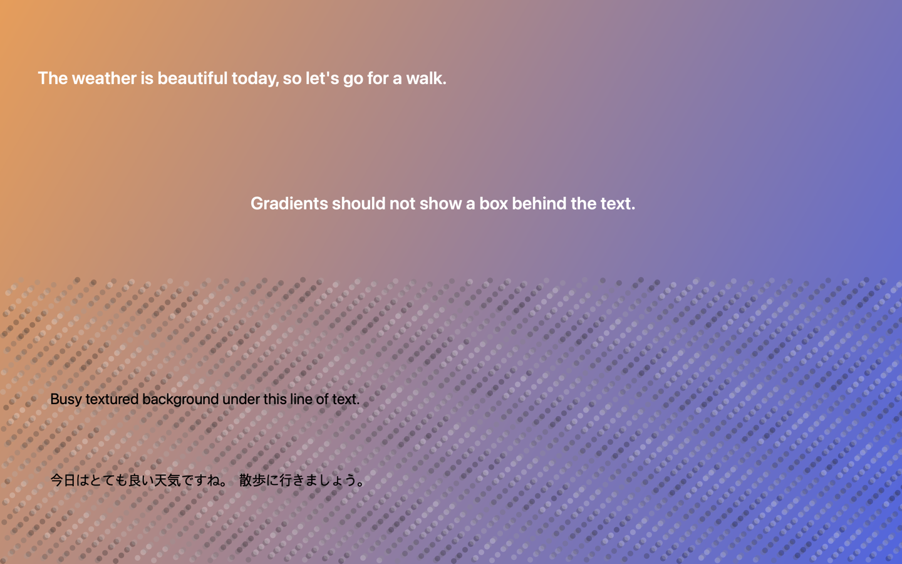
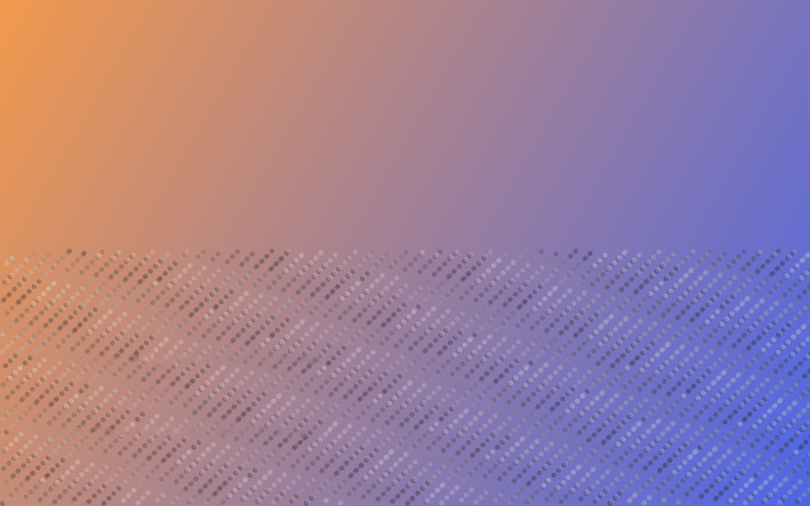
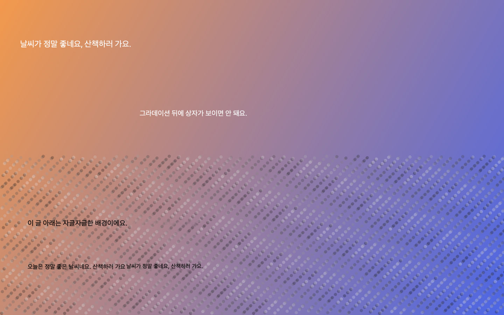

<p align="center"></p>

# 베일 (Veil)

맥 화면의 외국어를 **실시간으로** 한국어로 번역해서 원래 자리에 덮어 보여주는 메뉴바 앱.
스크롤하면 번역이 따라오고, 새로 나타난 글은 바로 번역돼요. 세로쓰기 일본어(만화 등)도 지원해요.

| 원래 화면 | 글자만 지운 배경 | 번역을 올린 결과 |
|---|---|---|
|  |  |  |

## 사용법

| 동작 | 방법 |
|---|---|
| 실시간 번역 켜기/끄기 | **⌃⌥T** (Control + Option + T) 또는 메뉴바 아이콘 |
| 원문 잠깐 보기 | **⌥(Option)** 누르고 있기 |
| 스크롤·클릭·타이핑 | 번역이 떠 있어도 평소처럼 하면 돼요 (마우스 입력은 아래 앱으로 통과) |
| 언어 팩 받기 | 메뉴바 아이콘 › 언어 팩 관리… |

처음 한 번은 아래 두 가지가 필요해요.
1. **화면 녹화 권한:** 시스템 설정 › 개인정보 보호 및 보안 › 화면 및 시스템 오디오 녹음 › 베일 켜기 → 앱 재실행
2. **언어 팩:** 메뉴바 › 언어 팩 관리에서 번역할 언어(예: 영어) 받기

## 빌드

```bash
./build.sh --run   # ~/Applications/Veil.app 으로 빌드·설치 후 실행
```

Xcode 없이 Command Line Tools의 `swiftc`로 직접 빌드해요.
로그인 키체인의 개인 인증서 **"ScreenTranslator Local Signing"**으로 서명해서, 다시 빌드해도 화면 녹화 권한이 유지돼요.
(인증서가 없으면 임시 서명으로 빌드되고, 그땐 빌드할 때마다 권한을 다시 켜야 해요.)

## 동작 원리

```
SCStream ─▶ Vision ─▶ 문단 묶기 ─▶ 캐시에 있음? ─예─▶ 새 위치에 바로 표시
(바뀐 프레임만)  (글자+위치)  (줄/열→문단)      └아니오─▶ Translation ─▶ 캐시 저장 ─▶ 표시
```

- 화면이 **바뀔 때만** 프레임이 들어와요 (화면 주사율에 맞춰 최대 초당 120번). 가만히 있으면 거의 CPU를 안 써요.
- **스크롤 따라가기:** 프레임마다 화면을 "가로줄별 밝기"로 요약해서 이전 프레임과 위아래로 맞춰 보고,
  움직인 양만큼 번역을 바로 옮겨요 (`MotionEstimator.swift`). 직전 이동량 근처부터 찾아서 연속 스크롤 중엔 프레임당 0.1ms 미만이에요.
- **부드러운 이동:** 번역 블록은 바뀔 때만 그림으로 한 번 그리고, 스크롤할 땐 Core Animation 레이어 위치만 옮겨요 (`BlockLayerView`, 1회 약 0.04ms).
- 스크롤 중인데 이동량을 못 구한 곳(아주 빠른 휙 넘기기 등)의 번역은 엉뚱한 자리에 멈춰 있지 않게 잠깐 숨겼다가, 다음 인식 때 제자리에 다시 띄워요.
- 글자 인식이 끝나면 정확한 위치로 보정하는데, 인식하는 동안 더 스크롤된 만큼도 함께 반영해요.
- 한 번 번역한 문단은 캐시에 저장돼서 다시 번역하지 않아요. 새 번역이 올 때까지는 기존 번역을 남겨둬서 깜빡이지 않아요.
- **깜빡임 방지:** 글자 인식이 한두 글자 다르게 읽어도(예: Hello → Hel1o) 비슷한 원문의 번역을 그대로 이어 보여줘요.
  숫자가 다르면 다른 글로 봐요. 위치가 1~2pt 흔들리는 건 무시하고, 번역 창은 캡처에서 빼서 자기 번역을 다시 읽지 않아요.
- 픽셀이 실제로 바뀐 프레임만 글자 인식을 해요 (커서 깜빡임 같은 작은 변화는 무시).
- **바뀐 부분만 인식:** 스크롤로 새로 드러난 곳이나 바뀐 곳만 가로 띠(최소 160pt)로 잘라 읽고,
  나머지 문단은 스크롤만큼 옮겨서 재사용해요 (전체 약 0.3초 → 띠 약 0.15초). 8번에 한 번은 전체를 읽어 바로잡아요.
- 번역 결과는 `~/Library/Application Support/Veil/translations.json`에 저장돼서 앱을 다시 켜도 바로 떠요.
- **발열 줄이기:** 스크롤·영상처럼 화면이 계속 바뀌는 동안엔 글자 인식을 쉬고, 0.25초 잠잠해지면 한 번만 해요.
  계속 바뀌는 화면이라도 1.5초에 한 번까지만 인식해요.
- **자연스러운 덮기:** 원문 영역에서 글자 픽셀만 지우고 주변 배경으로 메운 그림을 깔아요 (`BackgroundPatch.swift`).
  그라데이션·사진 위에서도 상자 티가 안 나요. 글자색은 원문에서 뽑아요 (`ColorSampler.swift`).
- 새 번역은 0.15초 동안 살짝 나타나요. 이미 번역이 있던 자리는 바로 바뀌어요.
- **번역 순서:** 시스템 번역은 한 번에 한 문장만 처리해요(동시 요청해도 안 빨라짐). 그래서 마우스 근처 문단부터
  하나씩 번역해서 끝나는 대로 바로 보여주고, 화면 밖으로 나간 문단은 건너뛰어요 (`TranslationQueue.swift`).
- 실시간 번역을 켜는 순간 번역 서비스를 미리 예열해요 (첫 번역 1~2초 → 약 0.3초).
- 언어 팩 창에서 **빠른 번역 모델**(macOS 26.4+)을 켜고 받을 수 있어요.
- 세로쓰기는 오른쪽→왼쪽 열을 하나의 문단으로 합쳐서 번역하고, 한국어는 가로로 읽기 좋게 표시해요.

측정치 (2880×1800): 글자 인식 약 0.27초, 문단 번역 약 0.3~0.8초씩 순서대로, 스크롤 추적 프레임당 약 0.5~3ms, 색 추출 1ms 미만

| 파일 | 역할 |
|---|---|
| `App.swift` | 메뉴바 앱, 단축키 등록 |
| `HotKey.swift` | Carbon 전역 단축키 |
| `LiveCapture.swift` | 화면 연속 캡처 (SCStream, 자기 창 제외), 스크롤 감지 |
| `MotionEstimator.swift` | 두 프레임을 비교해서 스크롤 양 계산 |
| `TextRecognizer.swift` | 글자 인식 + 줄/세로 열을 문단으로 합치기 |
| `Translator.swift` | 언어 판별 (가나 → 일본어), 번역 호출, 예열 |
| `LivePipeline.swift` | 프레임 → 인식 → 색 추출 → 번역 대기열 갱신 반복 |
| `TranslationQueue.swift` | 우선순위 번역 대기열 (마우스 근처부터, 하나씩 바로 표시) |
| `ColorSampler.swift` | 원문 배경색·글자색 추출 |
| `BackgroundPatch.swift` | 글자만 지운 배경 그림 만들기 |
| `TranslationController.swift` | 실시간 모드 켜고 끄기 |
| `Overlay.swift` | 클릭이 통과되는 투명 창, 번역 블록 레이어 표시, 상태 배지 |
| `LanguageSetupView.swift` | 언어 팩 다운로드 화면 |

## 다음에 해볼 것

- [ ] 드래그로 영역만 골라서 번역
- [ ] 단축키·대상 언어 설정 화면
- [ ] 여러 모니터 동시 지원
